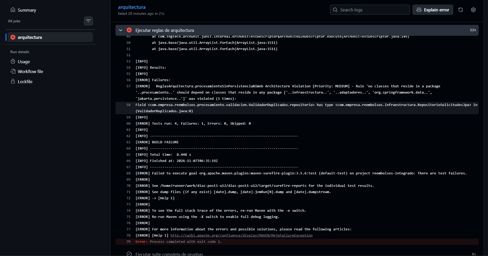
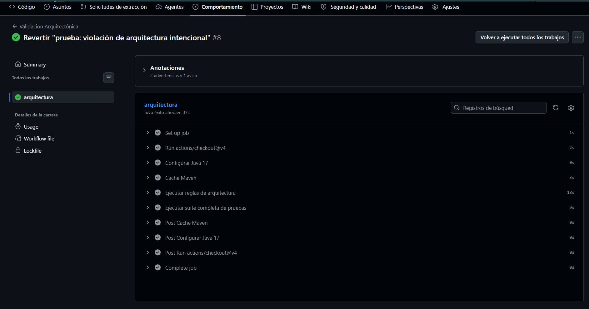

# Sistema de Solicitudes de Reembolso de Gastos Corporativos

Post-contenido — Proyecto Integrador de cierre · Patrones de Diseño de Software (UDES) · Unidad 12.
**Autora:** Natalia Díaz · **Stack:** Java 17, Spring Boot 4.1.2 (generado con start.spring.io), Maven, Spring Data JPA + H2, JUnit 5, ArchUnit 1.2.1, GitHub Actions.


**Contenido:** [Diseño Propuesto](#diseño-propuesto) · [Decisiones de diseño 1-4](#decisiones-de-diseño) · [Arquitectura resultante](#arquitectura-resultante) · [ADR-001](#resumen-de-adr-001) · [Qué se descartó y por qué](#qué-se-descartó-y-por-qué) · [ArchUnit y CI](#reglas-de-arquitectura-archunit-y-pipeline-ci) · [Evidencia del pipeline](#evidencia-del-pipeline) · [Pruebas](#pruebas) · [Cómo ejecutar](#cómo-ejecutar)

---

## Diseño Propuesto

> Esta sección se escribió **antes de implementar cualquier patrón** y quedó versionada en el commit de línea base
> `58e4825 docs: analizar requisitos y proponer diseno de patrones antes de implementar`, junto con el modelo de dominio.
> Cada justificación aplica el *test de explicabilidad* de la Guía (sección 1.2): una oración que dice por qué ese patrón y no otro.

| Requisito | Punto de variabilidad concreto | Patrón | Justificación (test de explicabilidad) |
|-----------|-------------------------------|--------|----------------------------------------|
| **RF1** — Validación en varias etapas | El conjunto y el orden de verificaciones que debe superar una solicitud (hoy: tope por categoría, documentos soporte, duplicados del período; mañana: límite anual acumulado). | **Chain of Responsibility** | Cada verificación es un eslabón independiente que rechaza o pasa al siguiente, de modo que el "límite anual acumulado" que planea Finanzas se agrega como un eslabón nuevo sin tocar los tres existentes; un `if` secuencial en el servicio obligaría a modificarlo cada vez. |
| **RF2** — Cálculo distinto por categoría | La fórmula del monto aprobado según la categoría (tope diario × días, monto completo hasta tope mensual, 80 % hasta tope anual; mañana: "bienestar"). | **Strategy** | Cada categoría tiene una fórmula propia e intercambiable detrás de la interfaz `CalculadoraReembolso`, así que agregar "bienestar" es crear una clase nueva sin modificar las otras fórmulas; un `switch` sobre `CategoriaGasto` obligaría a reabrir el mismo método por cada categoría. |
| **RF3** — Notificación simultánea | Cuántos interesados reaccionan a un cambio de estado y cómo reacciona cada uno (empleado: todo; Contabilidad: solo aprobaciones; Auditoría: todo; mañana: panel de métricas). | **Observer** | El servicio notifica a una lista de `ObservadorCambioEstado` sin conocerlos, de modo que el panel de métricas anunciado se suscribe como un observador más y cada interesado filtra sus propios eventos; llamar a cada notificador desde el servicio lo acoplaría a todos ellos. |

Los tres patrones resuelven problemas **distintos**: RF1 varía en *cuántos pasos se ejecutan y cuándo se corta*, RF2 en *qué algoritmo se elige* (se ejecuta exactamente uno) y RF3 en *cuántos receptores reaccionan a un mismo evento* (se ejecutan todos).

---

## Decisiones de Diseño

### Decisión de diseño 1: Orden de encadenamiento de los validadores (RF1)

* **Decisión tomada:** `ValidadorDocumentosSoporte` → `ValidadorMontoMaximo` → `ValidadorDuplicados`, ensamblados en `CadenaValidadores`.
* **Justificación técnica (eficiencia, fail-fast):** los dos primeros eslabones son O(1): leen un `boolean` y comparan un `BigDecimal` contra un tope en un `Map`. `ValidadorDuplicados` es el más caro, O(N), porque recorre la lista de solicitudes pendientes del empleado. Como la cadena se corta en el primer rechazo, ubicar el eslabón caro al final garantiza que solo se ejecute para solicitudes que ya superaron las verificaciones baratas.
* **Qué se gana con este orden:** las solicitudes incompletas o con monto excesivo, que son los errores más frecuentes al diligenciar, se rechazan sin recorrer la lista.
* **Qué se perdería con el orden inverso:** el recorrido O(N) se ejecutaría para todas las solicitudes, incluidas las que de todos modos serían rechazadas por datos incompletos.
* **Costo aceptado:** si una solicitud tiene varios problemas, el empleado solo ve el primero (por ejemplo, "Faltan documentos soporte" aunque además sea duplicada). Se acepta porque deberá corregir y reenviar de todas formas.

### Decisión de diseño 2: Selección de la calculadora con mapa inyectado por Spring (RF2)

* **Decisión tomada:** `SelectorCalculadora` recibe una `List<CalculadoraReembolso>` que Spring inyecta con todos los `@Component` que implementan la interfaz y la convierte en un `Map<CategoriaGasto, CalculadoraReembolso>`. Se descarta un `switch` manual sobre `CategoriaGasto`.
* **Justificación técnica (OCP frente al RF2):** el RF2 exige agregar categorías nuevas "sin modificar el cálculo de las categorías existentes". Con el mapa inyectado, agregar "bienestar" significa crear `CalculadoraBienestar` (`@Component` que implementa `CalculadoraReembolso`) y el valor `BIENESTAR` en el enum; `SelectorCalculadora` y las tres calculadoras existentes no cambian. Con un `switch`, cada categoría nueva obliga a reabrir y recompilar el selector, lo que viola el principio Abierto/Cerrado.
* **Beneficio adicional:** `Collectors.toMap` lanza una excepción al arrancar si dos calculadoras declaran la misma categoría, así que un error de configuración se detecta al iniciar la aplicación y no en producción.
* **Costo aceptado:** la relación categoría → calculadora no se ve en un solo bloque de código; se descubre por convención (`getCategoria()`). Lo compensa la Regla 3 de ArchUnit, que exige que toda clase de `procesamiento.calculo` implemente la interfaz.

### Decisión de diseño 3: Capas simples para persistencia; seam de Observer para notificación

* **Decisión tomada:** `SolicitudReembolsoService` sigue dependiendo directamente de `RepositorioSolicitudesJpa`, sin puerto `RepositorioSolicitudes` intermedio. Para la futura API de Contabilidad no se agrega nada: `ObservadorCambioEstado` ya es el punto de extensión.
* **Justificación técnica:** el criterio de la Guía (sección 6.2), *3+ años con cambios de infraestructura*, se evaluó por separado para cada dependencia. Para la persistencia **no se cumple**: no hay ningún plan de cambiar de motor, así que un puerto tendría una sola implementación (YAGNI, y no alcanza la Rule of Three). Para la notificación **sí hay un cambio con fecha** (API externa de Contabilidad el próximo trimestre), pero el seam ya existe: solo cambiará la implementación interna de `NotificadorContabilidad`, sin tocar el servicio ni los otros observadores. Detalle completo en [`docs/adr/ADR-001.md`](docs/adr/ADR-001.md).

### Decisión de diseño 4: La Regla 1 permite estereotipos de Spring, pero no Spring Data, JPA ni Web

* **Decisión tomada:** la regla `procesamientoSinPersistenciaNiWeb` prohíbe que `..procesamiento..` dependa de `..infraestructura..`, `..adaptadores..`, `org.springframework.data..` y `jakarta.persistence..`, pero **no** prohíbe todo `org.springframework`. Por eso validadores, calculadoras y notificadores pueden seguir usando `@Component`.
* **Justificación técnica:** `@Component` es un metadato declarativo de inversión de control. No cambia la lógica del eslabón ni de la estrategia: las clases se pueden instanciar con `new` y probarse sin Spring, como hacen `ValidadoresTest` y `CalculadorasTest`. Además, es justamente lo que permite la inyección por lista de la que dependen la Decisión 2 y el Observer. En cambio, depender de `JpaRepository`, `EntityManager` o clases web sí acoplaría la lógica de negocio a una tecnología concreta: un validador que consultara la base de datos ya no sería testeable en memoria y rompería la decisión del Paso 2 de recibir la lista de pendientes ya cargada. Prohibir todo `org.springframework` obligaría a mover el registro de beans a clases `@Configuration` externas, con más código y sin ningún aislamiento adicional (KISS).
* **Ajustes conscientes respecto al código de referencia de la guía:**
  * **Regla 2:** se agregó `..adaptadores.rest..` a los paquetes permitidos, porque `onlyAccessClassesThat` también cuenta el acceso del controlador a sus propios campos (`this.servicio`) y a su `ManejadorErroresRest`.
  * **Regla 3:** se excluye `SelectorCalculadora`, porque reside en `procesamiento.calculo` pero es el contexto del Strategy, no una estrategia. Sin la exclusión, la regla fallaría por un falso positivo.

---

## Arquitectura resultante

Capas simples, con un núcleo de procesamiento aislado de la persistencia y de la web. Ese aislamiento lo verifica ArchUnit en cada push.

```
com.empresa.reembolsos
├── ReembolsosApplication
├── dominio/                 SolicitudReembolso, CategoriaGasto, EstadoSolicitud
├── procesamiento/           Lógica de negocio (sin JPA, Spring Data ni web — Regla 1)
│   ├── validacion/          Chain of Responsibility: ValidadorSolicitud → Documentos → MontoMaximo → Duplicados (CadenaValidadores)
│   ├── calculo/             Strategy: CalculadoraReembolso → Viaje / Representacion / Capacitacion (SelectorCalculadora)
│   └── notificacion/        Observer: ObservadorCambioEstado → NotificadorEmpleado / Contabilidad / Auditoria
├── aplicacion/              SolicitudReembolsoService (único orquestador) + SolicitudInvalidaException
├── infraestructura/         RepositorioSolicitudesJpa (JpaRepository + findByEmpleadoIdAndEstado)
└── adaptadores/rest/        SolicitudReembolsoController + ManejadorErroresRest (Regla 2)
```

**Flujo `POST /api/solicitudes`:** controlador → `SolicitudReembolsoService.crear` → carga las solicitudes `PENDIENTE` del empleado desde `RepositorioSolicitudesJpa` → `CadenaValidadores` (que nunca toca la base de datos) → si hay rechazo, `SolicitudInvalidaException` → `ManejadorErroresRest` responde **HTTP 400** con `{"error": "<motivo>"}` → si es válida, `SelectorCalculadora` elige la estrategia, se fija el `montoAprobado`, estado `PENDIENTE` y se persiste.

**Flujo `PUT /api/solicitudes/{id}/estado`:** se actualiza y persiste el estado, y luego se notifica a **todos** los `ObservadorCambioEstado`. `NotificadorContabilidad` solo actúa si el nuevo estado es `APROBADA`, y `NotificadorAuditoria` registra cualquier cambio.

> **Nota sobre el modelo de dominio.** El Paso 1 se versionó con `SolicitudReembolso` como POJO puro, sin Spring ni JPA (commit `58e4825`). Como el Paso 5 exige que `RepositorioSolicitudesJpa` extienda `JpaRepository<SolicitudReembolso, Long>`, la clase necesita estar mapeada como entidad, y se anotó con `@Entity`, `@Id` y `@Enumerated`. Es la consecuencia directa de la Decisión 3 (sin puerto ni mapper de persistencia). La alternativa de mantener el dominio puro se analiza en el punto 4 de [Qué se descartó y por qué](#qué-se-descartó-y-por-qué). Las anotaciones son solo metadatos: `procesamiento` sigue sin depender de `jakarta.persistence`, como verifica la Regla 1.

---

## Resumen de ADR-001

Documento completo: [`docs/adr/ADR-001.md`](docs/adr/ADR-001.md) — **Estado:** Aceptado — 2026-11-06.

* **Pregunta:** ¿migrar a Hexagonal completa (puertos para persistencia y notificación) o mantener capas simples?
* **Criterio (Guía, sección 6.2), evaluado por dependencia:**

| Dependencia | ¿Cambio de infraestructura real y documentado? | Resultado |
|-------------|-----------------------------------------------|-----------|
| Persistencia | No: no existe plan de cambiar de motor | Capas simples, sin puerto (YAGNI) |
| Notificación a Contabilidad | Sí: API externa el próximo trimestre | Sin cambios: `ObservadorCambioEstado` ya es el seam |

* **Alternativas consideradas:** (1) Hexagonal completa, (2) puerto solo para notificación (`ServicioPagosExterno`), (3) capas simples más el seam de Observer existente (**elegida**).
* **Consecuencias positivas:** ninguna interfaz ni mapper especulativo, y el único cambio con fecha conocida ya tiene su punto de extensión.
* **Consecuencias negativas:** si algún día cambia el motor de base de datos, el puerto deberá introducirse de forma retroactiva (deuda técnica aceptada conscientemente). Además, la asimetría entre persistencia y notificación puede parecer inconsistente a quien no lea el ADR.

---

## Qué se descartó y por qué

Criterio aplicado (Guía, sección 4.2): ¿la variabilidad que justificaría la alternativa es **real y documentada hoy**, o es especulación sobre un futuro que aún no llegó? Ningún descarte es definitivo. Cada uno indica la señal que haría reconsiderarlo.

### 1. `ApplicationEventPublisher` en vez de una lista de observadores inyectada *(ejemplo de referencia de la Guía)*
* **Qué se consideró:** publicar un evento de dominio con `ApplicationEventPublisher` y escucharlo con `@EventListener` (Guía, sección 2.3) en lugar de inyectar `List<ObservadorCambioEstado>`.
* **Por qué se descartó:** con exactamente tres observadores fijos y conocidos en tiempo de compilación, un bus de eventos genérico no aporta desacoplamiento real, porque la interfaz `ObservadorCambioEstado` ya lo logra. En cambio, sí dificulta rastrear en el código quién reacciona a qué cambio, que es el costo de depuración que advierte la Guía sobre Observer con eventos. No pasa el test de explicabilidad: no hay una oración que justifique la indirección extra.
* **Señal para reconsiderarlo:** que las notificaciones deban ser asíncronas (`@Async`), ejecutarse solo tras confirmar la transacción (`@TransactionalEventListener`) o salir del proceso hacia un broker (RabbitMQ o Kafka).

### 2. Visitor o Abstract Factory para exportar reportes en varios formatos *(ejemplo de referencia de la Guía)*
* **Qué se consideró:** anticipar que Contabilidad pediría exportar el historial en PDF y Excel además de CSV, y construir desde ahora una jerarquía de exportadores.
* **Por qué se descartó:** hoy solo existe el requisito de CSV y no hay una segunda solicitud real de otro formato. No se cumple la **Rule of Three** (Guía, sección 4.2), y construir la abstracción ahora sería resolver un problema que todavía no existe (**YAGNI**).
* **Señal para reconsiderarlo:** una solicitud formal de un segundo formato, con un tercero en el horizonte (Rule of Three).

### 3. Jerarquía de excepciones por validador en vez de una sola `SolicitudInvalidaException` *(elemento propio)*
* **Qué se consideró:** durante la implementación del Paso 5 se consideró crear `DocumentosFaltantesException`, `TopeExcedidoException` y `SolicitudDuplicadaException`, derivadas de una base común, en lugar de una única `SolicitudInvalidaException` con el motivo como texto.
* **Por qué se descartó:** hoy existe **un solo consumidor** de esas excepciones, `ManejadorErroresRest`, y trata todos los rechazos igual: **HTTP 400** con el motivo en el cuerpo. Tres clases nuevas no cambiarían ningún comportamiento observable (**YAGNI**, **KISS**). Además, cada nuevo validador del RF1 obligaría a crear también su excepción, lo que duplicaría el punto de extensión que ya ofrece la cadena. No pasa el test de explicabilidad: no se puede explicar en una oración qué problema real resuelve hoy.
* **Señal para reconsiderarlo:** que algún consumidor necesite **reaccionar distinto según el tipo de rechazo**. Por ejemplo, que el frontend lleve al empleado a "adjuntar documentos" solo en ese caso, que la API exponga códigos de error por tipo, o que la Auditoría deba contabilizar rechazos por causa. Si eso pasa, la evolución mínima sería un `enum MotivoRechazo` dentro de `ResultadoValidacion`, antes que una jerarquía de clases.

### 4. Entidad JPA separada con mapper (o `orm.xml`) para mantener el dominio libre de JPA *(elemento propio)*
* **Qué se consideró:** al anotar `SolicitudReembolso` con `@Entity` se evaluó mantener el dominio puro con una `SolicitudReembolsoEntity` en `infraestructura` más un mapper dominio↔entidad, o con un mapeo externo en `META-INF/orm.xml`.
* **Por qué se descartó:** es la mitad de una arquitectura Hexagonal que el ADR-001 ya rechazó para la persistencia. Duplicaría los nueve campos en dos clases y agregaría un mapper que hay que mantener sincronizado, todo para proteger al dominio de un cambio de tecnología que no está planeado (**YAGNI**). Las anotaciones JPA son metadatos que no alteran el comportamiento del dominio, y las pruebas unitarias siguen instanciándolo con `new` sin base de datos.
* **Señal para reconsiderarlo:** la misma que reabriría el ADR-001, es decir, un plan real de cambiar el mecanismo de persistencia. También lo justificaría que el modelo de persistencia empiece a divergir del de negocio, por ejemplo con columnas de auditoría o versiones que no pertenecen al dominio.

---

## Reglas de arquitectura (ArchUnit) y pipeline CI

[`src/test/java/com/empresa/reembolsos/ReglasArquitectura.java`](src/test/java/com/empresa/reembolsos/ReglasArquitectura.java) define 4 reglas, coherentes con el ADR-001 (ninguna asume puertos de persistencia):

| # | Regla | Qué garantiza |
|---|-------|---------------|
| 1 | `procesamientoSinPersistenciaNiWeb` | Ninguna clase de `..procesamiento..` depende de `..infraestructura..`, `..adaptadores..`, `org.springframework.data..` ni `jakarta.persistence..` |
| 2 | `controladorSoloUsaServicio` | `adaptadores.rest` solo accede a `aplicacion`, `dominio`, su propio paquete, Spring Web/HTTP y `java..` |
| 3 | `calculadorasImplementanInterfaz` | Toda clase concreta de `procesamiento.calculo` (excepto el contexto `SelectorCalculadora`) implementa `CalculadoraReembolso` |
| 4 | `notificadoresImplementanInterfaz` | Toda clase concreta de `procesamiento.notificacion` implementa `ObservadorCambioEstado` |

El workflow [`.github/workflows/arquitectura.yml`](.github/workflows/arquitectura.yml) (job `arquitectura`) se ejecuta en cada push y pull request a `main`. Primero corre `mvn test -Dtest=ReglasArquitectura` y luego la suite completa con `mvn verify`.

### Evidencia del pipeline

**1. Build fallido por violación intencional de la Regla 1.** En el commit `4b82880 test: violacion de arquitectura intencional` se agregó a `ValidadorDuplicados` un campo de tipo `RepositorioSolicitudesJpa`. El job `arquitectura` falla en el paso *Ejecutar reglas de arquitectura* (`Tests run: 4, Failures: 1`) con la violación de `procesamientoSinPersistenciaNiWeb` sobre `ValidadorDuplicados`. El paso *Ejecutar suite completa de pruebas* no llega a ejecutarse.



**2. Build en verde tras `git revert HEAD`.** El commit `a799572 Revert "test: violacion de arquitectura intencional"` deshace el cambio, y las 4 reglas y `mvn verify` vuelven a pasar.



> **Nota de aprendizaje.** Un primer intento solo agregó la sentencia `import` sin usarla, y la Regla 1 **no** falló. Es el comportamiento esperado: ArchUnit analiza el bytecode y `javac` descarta los imports no usados, así que no existe una dependencia real. La violación tiene que materializarse en el código (un campo, un parámetro o una llamada) para que ArchUnit la detecte.

---

## Pruebas

| Tipo | Clase | Pruebas |
|------|-------|---------|
| Unitarias — un caso por validador (Chain of Responsibility) | `ValidadoresTest` | 3 |
| Unitarias — un caso por calculadora (Strategy) | `CalculadorasTest` | 3 |
| Integración `@SpringBootTest`: flujo crear → validar → calcular → cambiar estado → notificar | `SolicitudIntegracionTest` | 4 métodos (6 ejecuciones) |
| Arranque del contexto | `ReembolsosApplicationTests` | 1 |
| Arquitectura (ArchUnit) | `ReglasArquitectura` | 4 |

`SolicitudIntegracionTest` cubre:
* el flujo completo para **las 3 categorías** (prueba parametrizada que verifica el monto aprobado de cada fórmula);
* el rechazo de una solicitud **sin documentos soporte** con el mensaje `"Faltan documentos soporte"`;
* que ante un cambio de estado reaccionan los tres observadores, y que **Contabilidad solo actúa con `APROBADA`** (se verifica capturando la salida).

### Limitación conocida (heredada del enunciado)
En `ValidadorMontoMaximo` el tope de `VIAJE` es 150.000 por solicitud, mientras que `CalculadoraViaje` usa 150.000 **por día**. Por la API, un viaje de varios días nunca supera los 150.000 aprobados, así que la multiplicación por días solo se nota con prueba unitaria directa sobre la calculadora. Se conservan los valores del enunciado. Si Finanzas confirma que el tope de viaje es diario, el ajuste se limita a `ValidadorMontoMaximo` y no afecta la estrategia.

---

## Trazabilidad de commits

| Paso de la guía | Commit |
|-----------------|--------|
| P1 · Paso 1 — Diseño Propuesto y dominio (línea base) | `58e4825 docs: analizar requisitos y proponer diseno de patrones antes de implementar` |
| P1 · Paso 2 — RF1 Chain of Responsibility | `e673f86 feat: implementar cadena de validadores para las solicitudes de reembolso` |
| P1 · Paso 3 — RF2 Strategy | `ebf2a41 feat: implementar estrategias de calculo por categoria de gasto` |
| P1 · Paso 4 — RF3 Observer | `726b09a feat: implementar notificacion a interesados ante cambios de estado` |
| P1 · Paso 5 — Servicio y controlador | `61362b2 feat: ensamblar SolicitudReembolsoService y el controlador REST` |
| P1 · Pruebas | `86bf755 test: agregar 6 pruebas unitarias y 1 prueba de integracion SpringBootTest` |
| P2 · Paso 1 — ADR-001 | `6638861 docs: agregar ADR-001 con la decision arquitectonica de persistencia y notificacion` |
| P2 · Paso 2 — ArchUnit | `5c23a0b` / `c8f912e test: agregar dependencia ArchUnit y las 4 reglas de arquitectura en ReglasArquitectura` (el segundo reubica las pruebas unitarias) |
| P2 · Paso 3 — GitHub Actions | `902e711 ci: agregar workflow de GitHub Actions para validacion arquitectonica` |
| P2 · Paso 4 — Análisis de impacto | `8c7f769 docs: documentar analisis de impacto y patrones descartados por sobreingenieria` |
| Corrección para ejecutar el flujo completo | `522169c fix: agregar clase principal ReembolsosApplication, mapear entidad y corregir tests` |
| P2 · Paso 5 — Violación intencional y revert | `4b82880 test: violacion de arquitectura intencional` → `a799572 Revert "test: violacion de arquitectura intencional"` |
| P2 · Paso 6 — README consolidado | commits `docs:` finales |

---

## Cómo ejecutar

```bash
./mvnw test -Dtest=ReglasArquitectura   # solo reglas de arquitectura (4 pruebas)
./mvnw verify                           # suite completa
./mvnw spring-boot:run                  # API en http://localhost:8080/api/solicitudes
```

Ejemplos con la aplicación en ejecución:

```bash
# Crear (capacitación: 1.000.000 → aprobado 800.000)
curl -X POST localhost:8080/api/solicitudes -H "Content-Type: application/json" \
  -d '{"empleadoId":"EMP-01","categoria":"CAPACITACION","montoSolicitado":1000000,"fechaGasto":"2026-11-06","diasViaje":0,"documentosSoporte":true}'

# Rechazo sin documentos → HTTP 400 {"error":"Faltan documentos soporte"}
curl -i -X POST localhost:8080/api/solicitudes -H "Content-Type: application/json" \
  -d '{"empleadoId":"EMP-02","categoria":"REPRESENTACION","montoSolicitado":500000,"fechaGasto":"2026-11-06","documentosSoporte":false}'

# Aprobar → notifica a Empleado, Contabilidad y Auditoría (ver consola)
curl -X PUT localhost:8080/api/solicitudes/1/estado -H "Content-Type: application/json" -d '"APROBADA"'
```
